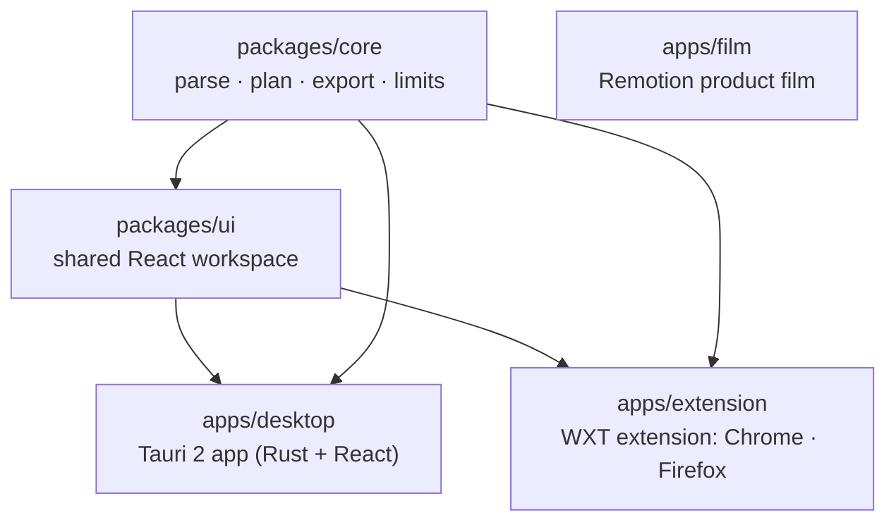
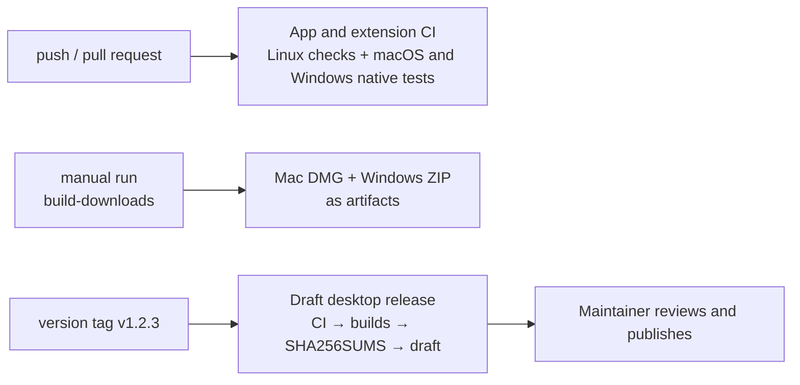

# Contributing to Handoff

Thanks for helping. Bug reports, fixes and improvements are welcome.

## Report a bug

Open an [issue](https://github.com/paarths-collab/handoff/issues) with your Handoff version, platform and browser, what you did, and what happened. Add the app's **Copy diagnostic** output if you can - it holds only counts. Never attach your real sidebar file, exports or private links. For security problems, follow [SECURITY.md](SECURITY.md) instead.

## Make a change

1. Fork the repository and create a branch.
2. Set up as described in [Run it from source](#run-it-from-source).
3. Make your change and add or update tests.
4. Run `pnpm check`. For UI changes also run `pnpm build` and `pnpm e2e`; for native changes run `cargo test --locked` and `cargo clippy --locked --all-targets -- -D warnings` in `apps/desktop/src-tauri`.
5. Open a pull request that explains what changed and why, with a screenshot for visible changes.

## Ground rules

- Keep processing local. No telemetry, accounts or uploads.
- Use synthetic fixtures (`.test` links, invented titles) in tests and screenshots; `pnpm check` rejects private data in fixtures.
- Pin any new GitHub Action to a full commit SHA; `pnpm check-workflows` enforces it.
- By contributing, you agree your contribution is released under the [MIT License](LICENSE).

## Developer guide

### What's in this repository



| Path | What it is |
|---|---|
| `packages/core` | Reads Arc sidebars and Handoff packs, plans moves, exports bookmarks/archive/CSV/pack, enforces import limits |
| `packages/ui` | The shared preview workspace used by the app and the extension |
| `apps/desktop` | The native app (Tauri 2). Rust side: file discovery and grants, profile listing and launching, saving exports |
| `apps/extension` | The browser extension that creates tabs, tab groups and bookmarks, with Undo |
| `apps/film` | The product film, written in [Remotion](https://www.remotion.dev); see [its README](apps/film/README.md) |
| `scripts/` | Packaging, the Mac installer and repository checks |

The website, web converter and browser guides live in the separate [handoff-website](https://github.com/paarths-collab/handoff-website) repository.

### Run it from source

You need the Node version in `.nvmrc`, the pnpm version in `package.json` and the [Tauri 2 prerequisites](https://v2.tauri.app/start/prerequisites/) for your platform.

```sh
git clone https://github.com/paarths-collab/handoff.git
cd handoff
pnpm install --frozen-lockfile
pnpm --filter @handoff/desktop exec tauri dev
```

Choose [`fixtures/tiny.json`](fixtures/tiny.json), a synthetic sidebar with one Space and three tabs. Synthetic `.test` links do not resolve on the internet.

For the extension, run `pnpm --filter @handoff/extension build` and load `apps/extension/.output/chrome-mv3` unpacked in a disposable Chromium profile.

Prefer a coding agent? Open the folder in Claude Code, Codex or Cursor and paste the [setup prompt](docs/setup-prompt.txt) ([guide](docs/agent-setup.md)). It installs dependencies and launches the app; it never commits, publishes or changes your browsers on its own.

### Checks

| Command | What it runs |
|---|---|
| `pnpm check` | TypeScript, lint, formatting, unit and property tests, builds, manifest and fixture-privacy checks, the pinned-Actions check and the production dependency audit |
| `pnpm e2e` | Playwright: the desktop UI with a mocked native bridge and the real Chromium extension (run `pnpm build` and `pnpm exec playwright install chromium` first) |
| `pnpm mutation` | Mutation tests for the core engine |
| `cargo test --locked` · `cargo clippy --locked --all-targets -- -D warnings` | Native tests and lints, in `apps/desktop/src-tauri` |

### CI and releases



- Every third-party GitHub Action is pinned to a commit SHA, and Rust to a fixed version. The only job that can write to the repository runs no third-party Actions.
- **To release:** bump the version in the root, desktop and extension `package.json`, `tauri.conf.json`, `Cargo.toml` and `Cargo.lock`. Commit, tag (`vX.Y.Z`) and push the tag. Run **Actions → Draft desktop release** with that tag. Review the draft, then publish it.
- To build a Windows download yourself on Windows x64 (Rust MSVC, Visual Studio C++ Build Tools): `pnpm install --frozen-lockfile` then `pnpm package:windows`.
- Builds use ad hoc macOS signing; Apple notarization and Windows code signing are not configured yet.

### More

[Changelog](CHANGELOG.md) · [Contributing](CONTRIBUTING.md) · [Security policy](SECURITY.md) · [Threat model](docs/security/threat-model.md) · [Arc file format](docs/arc-format.md) · [Build decisions](docs/decisions.md) · [Third-party notices](THIRD_PARTY_NOTICES.md)
