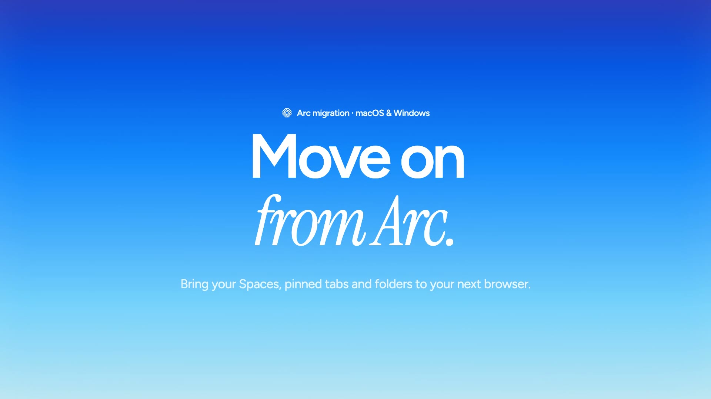
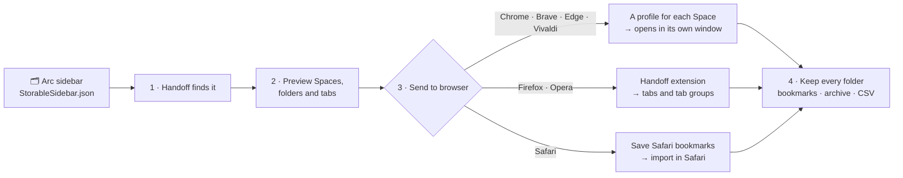
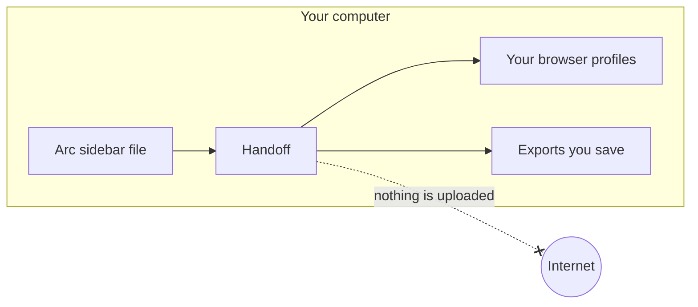

<div align="center">


# Handoff

**Move on from Arc - without starting over.**

Bring your Spaces, pinned tabs and folders from Arc to Chrome, Brave, Edge, Vivaldi, Opera, Firefox or Safari.
Everything happens on your computer. No account, no upload.

[**Website**](https://um2.us/q/nCuQnjWlY) · [**Download**](https://github.com/paarths-collab/handoff/releases/latest) · [What moves](#what-moves-with-you) · [Privacy](#your-data-stays-on-your-computer) · [Report a problem](#found-a-problem)

[](https://github.com/paarths-collab/handoff/releases/latest)
[](LICENSE)


</div>

---

## What is Handoff?

Arc is no longer moving forward, and starting over in a new browser means rebuilding years of Spaces, folders and tabs by hand. Handoff does that for you:

1. It **finds your Arc sidebar** on its own.
2. You **preview** every Space, folder and tab and choose what moves.
3. You **pick a browser and a profile for each Space**, already signed in - and each Space opens in its own window.
4. You **keep a copy** as bookmarks, a searchable archive or a spreadsheet.

### Demo

[](docs/media/handoff-film.mp4)

## Install

### Mac - one line in Terminal (recommended)

Open **Terminal** (press <kbd>⌘</kbd> <kbd>Space</kbd>, type *Terminal*, press <kbd>Return</kbd>), paste this and press <kbd>Return</kbd>:

```sh
curl -fsSL https://raw.githubusercontent.com/paarths-collab/handoff/main/scripts/install-mac.sh | bash
```

It downloads the latest release, checks it against the release's SHA-256 checksum, installs Handoff in **Applications** and opens it - without the "Apple could not verify" warning. Run the same line again any time to update. You can [read the script](scripts/install-mac.sh) first; it also puts the optional browser extensions in `~/Handoff Extras`.

### Mac - download the disk image

1. Download `handoff-<version>-macos-universal.dmg` from the [latest release](https://github.com/paarths-collab/handoff/releases/latest). It works on Apple Silicon and Intel Macs.
2. Open it and drag **Handoff** into **Applications**.
3. The first time you open it, macOS says *"Handoff" Not Opened* because Handoff is not yet notarized by Apple. Click **Done**, then open **System Settings → Privacy & Security**, scroll down and click **Open Anyway** next to Handoff.

### Windows (x64)

1. Download `handoff-<version>-windows-x64.zip` from the [latest release](https://github.com/paarths-collab/handoff/releases/latest) and extract it.
2. Run **Handoff-Setup.exe**. If Windows shows *"Windows protected your PC"*, click **More info → Run anyway** (the installer is not yet signed).
3. Open Handoff from the **Start** menu. The installer adds Microsoft WebView2 if it is missing (needs internet).

> [!NOTE]
> Windows builds pass automated tests on Windows, but have had less real-world use than the Mac app. Please [report anything odd](https://github.com/paarths-collab/handoff/issues).

## How it works



### Step by step

1. **Open Handoff.** It looks for your Arc sidebar file and shows **Arc sidebar found**. You can also choose a file yourself ([where is it?](#where-is-my-arc-file)).
2. **Preview.** Spaces are on the left, folders and tabs on the right. Untick any Space you don't want to move.
3. **Send to browser.** Pick your new browser:
   - **Chrome, Brave, Edge or Vivaldi** - choose a profile for each Space (for example *Work* for your work Space). Click **Open N tabs in M profiles**. Each Space opens in its own window, signed in as that profile. No extension needed.
   - **Firefox or Opera** - save a pack and open it in the [Handoff extension](#optional-tab-groups-with-the-extension).
   - **Safari** (Mac) - click **Save Safari bookmarks**, then in Safari choose **File → Import Browsing Data from File or Folder**.
4. **Keep every folder.** Tabs open as plain tabs, so also save a bookmarks file for each profile to keep your nested folders. You can save an **Arc Archive** (a searchable web page of everything) or a **Spreadsheet** (CSV) too.
5. **Move your passwords** (optional). Handoff shows you how to export them from Arc and import them in each profile - Handoff itself never sees them.

### What moves with you

| From Arc | Moves | How |
|---|---|---|
| Spaces | ✅ | Each Space opens in its own window, in the profile you choose |
| Pinned tabs and Today tabs | ✅ | Opened as tabs (you can leave Today tabs out) |
| Folders, including nested ones | ✅ | Kept in the bookmarks file, or as tab groups with the extension |
| Favorites | ✅ | Opened in the profile you choose |
| Archived tabs | ✅ optional | **Recover archived tabs** reads Arc's archive file |
| Saved passwords | ✅ guided | Arc's own export → your browser's import. Handoff never reads them |
| Website logins and cookies | ❌ | You sign in to each site once in the new browser |
| History, Boosts, Easels, Notes | ❌ | Not part of the sidebar file |

Handoff opens up to 5,000 tabs per move and reads sidebars with up to 100,000 tabs and folders.

### Optional: tab groups with the extension

Opening in profiles gives you plain tabs. For **tab groups** (and for Firefox or Opera), use the Handoff extension that comes in every download:

1. Copy the **Handoff Extension** folder somewhere permanent (the browser loads it from there). With the Terminal install it is already in `~/Handoff Extras`.
2. In your browser, open the **Extensions** page, turn on **Developer mode**, click **Load unpacked** and choose that folder. In Firefox, open `about:debugging` → **This Firefox** → **Load Temporary Add-on** and pick **Handoff for Firefox.zip**.
3. In Handoff, open **Send to browser → Tab groups with the Handoff extension**, click **Save browser pack**, and open it in the extension. Review the preview and click **Move**. You can **Undo** in the same browser session.

### Full Disk Access on Mac (optional)

Handoff reads only the **names** of your browser profiles (such as *Work* or *Personal*) so you can pick them. Some Macs block that, and Handoff then lists profiles as *Default*, *Profile 1* and so on - you can still click **Show** to see which is which and type a name.

To let Handoff see the real names:

1. Open **System Settings → Privacy & Security → Full Disk Access**.
2. Click the **+** button at the bottom of the list (enter your password if asked).
3. Choose **Applications → Handoff** and click **Open**.
4. Make sure the switch next to **Handoff** is **on**.
5. **Quit Handoff** (<kbd>⌘</kbd> <kbd>Q</kbd>) and open it again.

Handoff also has a button that opens this settings page for you. You can turn the switch off again at any time. Handoff never reads passwords, cookies or history, with or without this access.

### Where is my Arc file?

Handoff finds it automatically. If you need to choose it yourself, the file is called **StorableSidebar.json**:

- **Mac:** `~/Library/Application Support/Arc/StorableSidebar.json` - in the file picker press <kbd>⌘</kbd> <kbd>⇧</kbd> <kbd>G</kbd> and paste that path.
- **Windows:** in Arc's folder under your user's `AppData\Local\Packages` (the folder name starts with `TheBrowserCompany.Arc`), in `LocalCache\Local\Arc`.

## Your data stays on your computer



- No account, no tracking and no upload in the app or extension. Handoff only reads the file you choose and saves files where you choose.
- Opening a tab contacts that website through your browser, as any tab would.
- Handoff never reads passwords, cookies or browsing history.
- Full details: [privacy](docs/privacy.md) · [security model](docs/security/threat-model.md).

## FAQ

**Is it free?** Yes, and open source under the [MIT license](LICENSE).

**Why does my Mac or PC warn me?** Handoff is not yet signed by Apple or Microsoft, which costs a yearly fee. The Terminal install avoids the Mac warning and checks the download's checksum. The code is public, so you can read exactly what it does.

**Will it change Arc?** No. Handoff only reads Arc's sidebar file. Arc keeps working as before.

**Can I undo a move?** With the extension, yes - **Undo** removes the tabs and bookmarks that move created, in the same browser session. Tabs opened in profiles are ordinary tabs you can close.

## Found a problem?

[Open an issue](https://github.com/paarths-collab/handoff/issues/new/choose):

1. Go to the **Issues** tab and click **New issue**.
2. Choose **Bug report** (or **Feature request** for an idea).
3. Describe **what happened**, **what you expected** and the **steps** that led there.
4. Add your Handoff version, your computer (Mac or Windows) and the browser you were moving to.
5. Optional but very helpful: in Handoff, open **Send to browser** and click **Copy diagnostic** at the bottom, then paste it in. It contains only counts - never your titles or links.

> [!IMPORTANT]
> Don't attach your real Arc sidebar file, exports, passwords or private links, and blur personal tab titles in screenshots. For a **security** problem, use **Security → Report a vulnerability** instead of a public issue ([details](SECURITY.md)).

## License

Developers: see [CONTRIBUTING.md](CONTRIBUTING.md) to build, test and release Handoff.

Handoff is released under the [MIT License](LICENSE). Browser logos, fonts and the film's audio belong to their owners; see [third-party notices](THIRD_PARTY_NOTICES.md). Handoff is not affiliated with The Browser Company or any browser maker.
